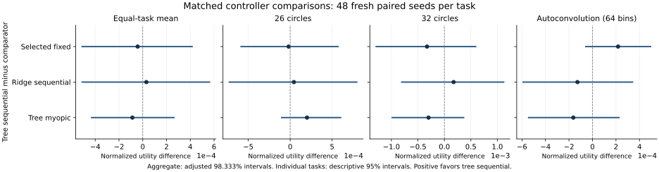
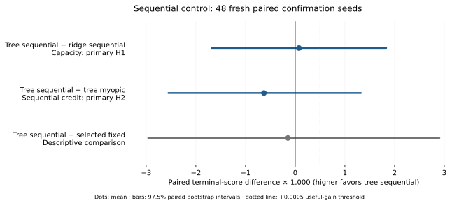
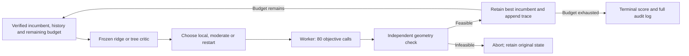

# Astrax: current evidence and next decision

Updated November 18, 2026. This is the single active research brief. Completed
protocols remain evidence records, not competing experiment plans.

## Fresh-state diagnostic completed

On 72 fresh confirmation states the state-conditioned predictor changed 25
decisions relative to the time-only predictor. Its equal-task mean gain was
−0.000112814 normalized terminal utility (95% stratified paired bootstrap
interval [−0.000251036, +0.000015817]). The upper endpoint falls below the
prespecified useful gain of +0.0002. The fitted state predictor failed the
primary improvement criterion. The interval includes zero.

| Task | Different choices out of 24 | State minus time-only utility |
|---|---:|---:|
| 26-circle packing | 14 | −0.000274424 |
| 32-circle packing | 4 | −0.000091554 |
| First autoconvolution, 64 coefficients | 7 | +0.000027536 |

This result narrows the explanation for the preceding suite. Correcting the
known conditioning issue and supplying direct terminal labels still gave no
measurable benefit from the observed features with this linear predictor.
Each task/window regression has only 16 training states. The intervals
condition on those fits, one realization per action, fixed-policy prefixes
and continuations, and late checkpoints. Richer observations, larger training
sets and different continuations remain open possibilities.

The conditioning rule also removed the problematic initial radius-CV column
when applied to the 96 historical training states. Protocol commit `ee3be85`
preceded collection. The offline audit rechecks all 648 terminal constructions,
fresh seed assignments, refitted predictions and the paired summary. Intermediate
trajectories were not archived in this diagnostic. Recorded function bodies used
1,311.38 seconds (about $0.0230 for CPU and memory, excluding overhead). The Modal
client emitted an iterator shutdown warning after each complete split. Both split
counts passed audit. [Modal run](https://modal.com/apps/ayushichadha/main/ap-jj0DPEPWl2O53TJyqtpOET)
and [saved evidence](artifacts/fresh-action-evidence.tar.gz).

## Three-task suite: completed confirmation

All 288 training paths, 48 validation seeds and 144 confirmation seeds completed.
There are 6,912 training transitions and 1,056 full evaluation rollouts, with
1,228,800 budgeted worker objective evaluations. Every task has 48 paired fresh
confirmation seeds. Models are fitted separately per task; this is not zero-shot
transfer. All models and fixed comparators froze before any confirmation dispatch.

None of the three predeclared primary improvement gates passed.

| Primary contrast | Equal-task normalized gain | Adjusted 98.333% interval | Gate |
|---|---:|---|---|
| Tree sequential − selected fixed | -0.000042777 | [-0.000510150, +0.000415338] | Not passed |
| Tree sequential − ridge sequential | +0.000030288 | [-0.000509384, +0.000562167] | Not passed |
| Tree sequential − tree myopic | -0.000087398 | [-0.000429721, +0.000261888] | Not passed |

The 26-circle ridge baseline is numerically fragile because a theoretically zero
radius-CV feature was scaled by about 6.5e-17. H2 therefore compares the frozen
implementations; it does not establish a clean capacity advantage over a
well-conditioned linear baseline. H1 and H3 do not use ridge.


Positive differences favor tree-sequential. The practical gate also requires mean
normalized gain >=0.0002. Individual task intervals in the figure are descriptive
95% intervals, not additional adjusted primary claims. Results condition on one
training sample and fit per method. Failure to establish superiority is not
an equivalence result.



| Policy | 26-circle sum ↑ | 32-circle sum ↑ | Problem-2 C ↓ |
|---|---:|---:|---:|
| ridge myopic | 2.625053000 | 2.925075980 | 1.523242569 |
| ridge sequential | 2.625928395 | 2.924234335 | 1.523100898 |
| tree myopic | 2.625479662 | 2.925745511 | 1.523029804 |
| tree sequential | 2.626056285 | 2.924789992 | 1.523356287 |
| selected | 2.626110014 | 2.925835555 | 1.523792187 |
| reactive | 2.623103566 | 2.924777444 | 1.527022573 |

On 32-circle packing, tree-sequential is lower than selected fixed search by
0.001045563 mean radius-sum units. On problem 2, its mean C is lower (better) by
0.000435900, with descriptive 95% interval for the reduction
[-0.000114703, +0.000988210]; it wins 32 seeds, loses 10 and ties 6. This is a
small, uncertain signal, not an established taskwise superiority result.

Validation selected always-moderate for both packing tasks and always-restart for
problem 2. Raw objectives have different units and are not averaged together.
The aggregate averages normalized gains across the three fixed tasks, weighting
packing twice; it does not estimate performance over all mathematical problems.
All runs start from seeded random constructions, not a record incumbent.
The 64-bin restriction is a computational benchmark, not reproduction of the
archived 600-bin construction or evidence of a mathematical record improvement.

### Conditional autoresearch decision

The development-only program-editing pilot was **not run**. The frozen trigger
required all primary gates to fail and at least one task's mean immediate
oracle-minus-best-constant action opportunity to be below 0.0002 normalized units
per window. Every task exceeds that opportunity threshold:

| Task | Training immediate oracle − best constant action |
|---|---:|
| packing26 | 0.000968820 |
| packing32 | 0.000902864 |
| autoconvolution64 | 0.000505111 |

This is a retrospective training diagnostic on random-behavior states, including time/state variation and
realized search randomness. It is not a deployable oracle, a generalization test,
or proof that the available features predict those differences. It does not show
that Karpathy-style code generation would fail. It does mean the declared rule
does not justify adding a program generator in this study. No additional LLM API
or pilot compute was purchased. The immediate prerequisite is to fix numerical
feature conditioning in a new version, without altering these frozen models.
A targeted next study would then test prediction and
ranking of action differences on fresh cloned states, with separate development
and confirmation data, before expanding the strategy portfolio.

### Suite evidence and resource accounting

Protocol commit `9ba9b4d` preceded collection. An audit-only call-count correction
was documented in `363cfa2` before confirmation: the planned unique job count is
487, while 490 is the dispatch ceiling. Original frozen sources are included in
the evidence archive. The corrected offline auditor permits only that identified
audit-source amendment; worker, model, statistics, seed and hypothesis sources
remain unchanged. A second observation-first audit amendment handles the
recorded ridge portability issue without refitting or changing any action. It also
checks the complete expected job set and all six freeze receipt entries. No numerical collection was repeated.

The observed portability issue and numerical baseline qualification are retained
in the manuscript and raw amendment receipt, not hidden by a larger tolerance.
The audit passes all 6,912 training transitions and 1,056 evaluation rollouts,
recomputes frozen-policy predictions, checks exact constructions and source/model
hashes, and reproduces the complete summary. The original cloud function log has
487 study calls plus one Linux audit call (488 total),
and 9395.43 recorded function-seconds including that audit,
approximately **$0.1648** at the published CPU/memory
rate. Build/startup/idle/egress are excluded; this is not a refreshed invoice.
The conservative function ceiling was $5.15676, with $2 prior-usage allowance and
$1 overhead reserve within the authorized $10. Training LP failures: 0.

[Initial collection](https://modal.com/apps/ayushichadha/main/ap-N33xf40wDu8UDz34xBt6JS),
[Linux audit](https://modal.com/apps/ayushichadha/main/ap-7vRC0UP5vUDnY1RPPc37VV),
and [continuation](https://modal.com/apps/ayushichadha/main/ap-yq49SlUT9mPiBQw6lwUT93).
[Full suite evidence](artifacts/benchmark-suite-evidence.tar.gz), SHA-256:
`c8007253f16607bc55aaebedca5ecad9a2cce2dabcea481a0356cc59f759439b`.

```bash
tar -xzf papers/metacontrol/artifacts/benchmark-suite-evidence.tar.gz
python -m scripts.audit_benchmark_suite --output outputs/benchmark-suite-v1
python -m scripts.plot_benchmark_suite --output outputs/benchmark-suite-v1
```

These commands make no cloud or API calls. Exact verification applies to stored
binary floating-point constructions. Budgeted fast evaluations exclude independent
verification and initialization; measured runtime includes that work. The new
suite does not retroactively turn the earlier floating-point study into an exact
certificate. Saved run durations cannot be reproduced by offline replay.

## Frozen benchmark suite: completed protocol

The completed extension fixes three tasks: packing 26 and 32 circles in the unit square
(AlphaEvolve problem 36), and the first autoconvolution inequality (problem 2),
restricted to 64 nonnegative coefficients. This is two mathematical families,
not three independent domains, and is not a record attempt or zero-shot transfer.
Reference notebook bytes are pinned at upstream commit
`8f447457957deac61e28bf1676746f0753b3b2f8`; extracted constructions and source SHA256
values are in `artifacts/benchmark-reference-audit.json`.
The archived 600-bin problem-2 construction scores 1.5052939684401607 under both
numpy and independently implemented integer/rational convolution. The published
32-circle float array has boundary/squared-distance margins -1.39e-17/-7.09e-18;
explicit radius contraction by 1e-9 gives an exactly feasible score
2.9395727682667503. Neither construction seeds the controller experiment.

Each task gets separate models, 96 training paths, 16 validation seeds and 48
untouched paired confirmation seeds, with new disjoint seed ranges. All tasks'
models and validation-selected comparators freeze before any confirmation.
Four learned arms retain ridge/tree × myopic/sequential, fixed hyperparameters,
three actions and eight windows of 80 objective calls. Static candidates are
always-local, always-moderate, always-restart and local-to-moderate at window 4;
a two-stagnant-window reactive policy is also evaluated. Packing reuses the
frozen SLSQP worker. Autoconvolution uses 20 LP directions per window, each with
four fixed mixtures; local/moderate perturbation or restart initializes a window.
All LP failures, objective counts and execution time are retained. Objective-call
matching is within a task; it does not match wall time or LP/constraint work.
Final incumbents at every window pass exact rational feasibility/scoring.
The counted unit is the worker proposal/objective evaluation: independent
verification, initialization and observation formation are additional work. For
autoconvolution, exact checks of improving proposals are outside the 80 fast
convolution evaluations and are included in measured worker time; their count is
not separately logged. Thus this is a matched search-budget comparison, not an
assertion of equal total score computations or equal CPU time.

Primary contrasts are tree-sequential minus (H1) selected static, (H2) ridge-
sequential and (H3) tree-myopic. Utility is packing score/sqrt(n/pi), or -C/2 for
autoconvolution. Equal-task mean differences have 20,000 paired bootstrap resamples
within tasks and 98.333% intervals (three-comparison Bonferroni adjustment).
A success requires mean >=0.0002 and lower endpoint >0. Taskwise 95% intervals
are descriptive. The aggregate weights packing twice because it contains two
tasks; it does not estimate performance over all mathematical problems.

The job list contains 487 planned unique calls. The dispatch ledger permits at
most 490 calls, each 1 CPU/2GiB/600 seconds,
zero retries, four concurrent containers. At the checked Modal rate this caps
function execution at $5.15676; $2 prior-usage allowance and $1 overhead reserve
keep the planned total below $10. Startup/build/idle charges are separate from
measured function time. No automatic retry or unbounded autoresearch is allowed.
An offline-auditor bookkeeping correction was identified during first-task
training, before fitting or confirmation: its completeness assertion must expect
487 calls, not the 490-call ceiling. Frozen sources are preserved in the evidence;
this changes no treatment, seed, model, result or spending cap.

The conditional autoresearch pilot is development-only: consider it only if all
three primary gates fail and at least one task has mean immediate oracle-minus-
best-constant action opportunity below 0.0002 normalized per window in training.
This is a screening heuristic, not proof of why control fails. Otherwise prioritize
controller evidence/support diagnostics. Any pilot must freeze its own candidate
budget and fresh development/validation seeds; suite confirmation is never reused.

Commands: `python -m scripts.benchmark_suite --prepare outputs/benchmark-suite-v1`,
then explicitly authorized `modal run -m scripts.modal_benchmark_suite --output
outputs/benchmark-suite-v1`. Offline verification uses
`python -m scripts.audit_benchmark_suite --output outputs/benchmark-suite-v1`.
For a paid reproduction, use a Linux client for the original native audit; the
saved-run continuation wrapper is `scripts/resume_benchmark_suite.py` and requires
the recorded Linux verification. Do not rerun a completed study merely to inspect it.

## Earlier sequential controller: completed study

The completed experiment tests repeated search-option decisions, rather
than the previous exactly-one-replacement stopping policy. Its frozen protocol is
in `scripts/sequential_controller.py::specification`; the CPU dispatcher is
`scripts/modal_sequential_controller.py`. All 96 training, 16 validation and 48 confirmation seeds are complete.

- **H1 (capacity):** tree sequential minus ridge sequential.
- **H2 (credit):** tree sequential minus tree myopic.
- Both require mean gain >=0.0005 and a positive lower endpoint of a paired
  97.5% bootstrap interval (20,000 seed resamples; two primary comparisons).
- Four learned arms form a capacity × credit comparison: ridge/tree, each with
  immediate-only or finite-horizon reward targets. Ridge-myopic is a diagnostic
  control; only H1/H2 are primary. The selected fixed comparator gap is descriptive.
- Eight windows ×80 objective calls, three available options (local, moderate,
  restart), independent geometry verification, immutable incumbent on failure.
  Switching is allowed repeatedly, has no artificial reward penalty, and is
  counted. Wall time and controller/observation overhead are measured separately.
- 96 fresh training seeds, 16 validation seeds selecting among always-local,
  always-moderate and local-to-moderate/window-4, then 48 fresh paired confirmation
  seeds. Training branches all three options at each visited state; a seeded
  uniform behavior policy chooses the continuing branch. This produces 2,304
  transitions; they are not 2,304 independent trajectories.
- Fixed ridge alpha=10; ExtraTrees uses 64 trees, depth<=5, leaf>=8, seed731.
  There is no hyperparameter search. Separate window/action regressors implement
  backward fitted Q iteration with gamma=1; myopic heads use gamma=0. Model choice
  and comparison rules freeze before confirmation. Ties favor local, then moderate.
- Each evaluation executes a fresh full rollout. Model artifacts are JSON arrays;
  source hashes, branch constructions, causal observations, action values and
  objective counts are retained. No learned controller is promoted automatically.
- Up to four CPU tasks, each capped at one core, 2GiB and 600 seconds, no retries.
  164-call conservative allowance: <=$1.725936 function execution plus $0.50 reserve,
  alongside the last observed $0.18 prior workspace usage, within $10. Actual
  invoice/credit accounting may lag and is separate from this rate-based bound.

ExtraTrees is the fixed nonlinear option for this controlled study, following
classical tree-based batch RL; it is not a boosted-tree or uncertainty-gated
implementation. Finite-horizon value targets test the value of future decisions,
not merely larger prediction models. Compressed observations may be non-Markov;
branch coverage at training states does not ensure coverage of learned rollouts.

The broader agent-runtime direction remains future work: versioned proposals,
capability admission, policy promotion/regression gates, and eventual LLM proposal
adapters. Geometry validation in this experiment is not a policy-improvement
certificate. No Tao/Einstein transfer, autonomous code invention, uncertainty
fallback or safe-improvement theorem is claimed. The work is metareasoning /
dynamic algorithm configuration grounded in a verified mathematical worker.

### Sequential results and what they mean

| Contrast | Mean difference | Paired 97.5% interval | Status |
|---|---:|---|---|
| Sequential H1: tree minus ridge | +0.000075914 | [-0.001680902, +0.001831500] | Improvement not established |
| Sequential H2: sequential minus myopic, tree | -0.000629639 | [-0.002553465, +0.001322107] | Improvement not established |
| Tree-sequential minus selected fixed | -0.000146703 | [-0.002958453, +0.002902246] | Descriptive |

Both primary tests fail to establish improvement. The intervals also include
useful positive effects, so this is not an equivalence result. Always-moderate was
selected using validation only. Ridge-myopic has the highest observed mean,
but that descriptive ranking is not a predeclared superiority finding.
Tree-sequential made 31 distinct action sequences across 48 seeds, averaging
3.79 switches, yet did not demonstrate better terminal outcomes. This is no
longer just clock collapse: adaptive behavior is present, useful policy value
remains unestablished. The best construction approaches but does not exceed the
archived reference; no record improvement is claimed.

| Policy | Mean terminal score | Mean switches | Mean episode seconds |
|---|---:|---:|---:|
| Always moderate (selected fixed) | 2.624710591 | 0.00 | 4.223 |
| Reactive | 2.621470007 | 1.94 | 4.981 |
| Ridge, myopic | 2.625304450 | 4.17 | 4.349 |
| ExtraTrees, myopic | 2.625193527 | 3.35 | 4.513 |
| Ridge, sequential | 2.624487974 | 5.21 | 4.138 |
| ExtraTrees, sequential | 2.624563888 | 3.79 | 4.442 |



The original combined repository passed 134 tests; Astrax passes the 41-test numerical subset. The offline audit verifies 2,304 training transitions and
336 evaluation rollouts, including model predictions and the complete result
summary. Recorded execution is 2,640.21 function-seconds, approximately **$0.0463**
for CPU/memory, excluding build/startup/idle/egress. This is not a refreshed
invoice. No paid collection was repeated after the audit-only amendment.

The [single evidence archive](artifacts/sequential-controller-evidence.tar.gz)
contains original and amended records, models and receipts. From a fresh checkout:

```bash
tar -xzf papers/metacontrol/artifacts/sequential-controller-evidence.tar.gz
python -m scripts.audit_sequential_controller --output outputs/sequential-controller-v2
python -m scripts.plot_sequential_controller
```

The audit uses saved data and does not call Modal. For a separately authorized
reproduction, prepare a new directory with
`python -m scripts.sequential_controller --prepare outputs/sequential-reproduction`
and run `modal run -m scripts.modal_sequential_controller --output outputs/sequential-reproduction`.
Do not rerun confirmation to select another model. This study is complete.

### Literature informing this study

- [Automated Dynamic Algorithm Configuration](https://arxiv.org/abs/2205.13881)
  and [DACBench](https://arxiv.org/abs/2105.08541): state-conditioned algorithm
  configuration across execution; relevant formulations and baselines.
- [Selecting Computations](https://proceedings.mlr.press/r10/hay12a.html): utility
  of computation and selection; ordinary cumulative-reward bandits are not an
  automatic match for terminal discovery objectives.
- [AIOS](https://arxiv.org/abs/2403.16971): runtime services and resource mediation;
  not evidence that our learned controller is novel or effective.
- [AlphaEvolve](https://arxiv.org/abs/2506.13131) and
  [ShinkaEvolve](https://arxiv.org/abs/2509.19349): program evolution and adaptive
  selection already exist; they must inform novelty and matched baselines.
- [SPIBB](https://proceedings.mlr.press/v97/laroche19a.html): baseline fallback
  under limited support, with assumptions that do not automatically transfer.
- [Conservative Q-Learning](https://arxiv.org/abs/2006.04779): offline value
  overestimation/distribution shift; useful comparator, not a generic safety proof.

The Exa discovery request is retained at `outputs/exa-audit/controller-dac.json`
and cost $0.007. Official papers/docs were also checked via web retrieval. This
is a targeted design audit, not an exhaustive literature review. Read and pin
full implementations before reproducing a method. No past.dev records were uploaded.

### Pre-fitting audit portability amendment

Cross-platform recomputation of an initial score differed by approximately 7e-16
between macOS and the pinned Linux worker. Bitwise trace equality was therefore
replaced with absolute tolerance 1e-12 (zero relative tolerance) for recomputed
observations/rewards/scores only. Feasibility stays strict; action and evaluation
counts stay exact. Original training records retain their original manifest
identity. There is no recollection or change to hypotheses, actions, training,
models, splits or selection rules. This is recorded before any model fitting or
validation/confirmation dispatch.

## Reading guide: ridge and the sequential controller

Ridge is linear regression with an L2 penalty. Given observed features x and a
training target y, it fits an intercept b and coefficients w by minimizing
`sum_i (y_i - b - x_i^T w)^2 + alpha * sum_j w_j^2`.
The intercept is unpenalized. We standardize each feature using training data only,
so units such as score, geometric clearance and contact count do not determine
which coefficients receive the strongest effective penalty. Alpha=0 recovers
ordinary least squares; a larger alpha shrinks slopes more strongly. Shrinkage
can reduce sensitivity to correlated/noisy features, but cannot create
information the observations do not contain. Alpha=10 here is a fixed study
setting, not a claim that 10 is universally best.

For this study, an observation summarizes the completed search: its score,
recent progress, geometry, last option and remaining budget. Each action/window
has its own model. A ridge head predicts a weighted sum of these features;
ExtraTrees averages shallow randomized regression trees, allowing conditions
and interactions such as "moderate perturbation is useful when progress has
stalled AND the remaining clearance is large." That sentence is an illustrative
possible rule, not a discovered result. Greater flexibility can also overfit.

The distinction between myopic and sequential is the training target:

- **Myopic:** how much verified score will this next window gain?
- **Sequential:** how much score can this action plus later controller decisions
  gain before the episode ends? We fit the last window first, then work backward,
  adding the next window's largest predicted action value to the observed gain.

At runtime the controller evaluates all three heads for the current window and
executes the option with the highest predicted value. Ridge by itself is a
regression method; embedded in this backward learning-and-choice procedure it
is the function approximator for a finite-horizon control policy. Switching to
neural networks is not required for the problem to be metacontrol. The scientific
question is whether the learned choices improve outcomes at a fair resource cost.

Read [the official ridge explanation](https://scikit-learn.org/1.8/modules/linear_model.html#ridge-regression-and-classification)
first, then [ExtraTrees parameters](https://scikit-learn.org/1.8/modules/generated/sklearn.ensemble.ExtraTreesRegressor.html),
and finally [Ernst, Geurts and Wehenkel on tree-based batch reinforcement learning](https://jmlr.org/papers/v6/ernst05a.html).
The last paper explains why a sequence of regression fits can learn action values.
Our small, compressed-state experiment does not inherit a general convergence or
safe-policy-improvement guarantee from that literature.

The implemented runtime loop is:



## Research objective

Extend paper 2's adaptive-controller question: can observations identify when a
persistent strategy should be revised to improve terminal verified outcomes under
a controlled budget? [Paper 1](https://arxiv.org/abs/2606.03741) supplies the
persistent-commitment mechanism; [paper 2](https://arxiv.org/abs/2609.00874)
distinguishes scores, actions and useful policy value. Numerical search tests the
question with an explicit worker. It is not an HRM/feudal architecture transfer.

## What the completed work establishes

| Study | Data | Main finding |
|---|---|---|
| Timing opportunity | 12 development seeds | Retrospective oracle exceeds best fixed timing by 0.002429; not a deployable result |
| Progress-conditioned prediction | 24 train / 12 validation / 24 confirmation | State and time policies choose the same late clock on every confirmation seed; zero advantage |
| Geometry/revision-quality follow-up | 24 train / 12 validation / 48 fresh confirmation | Moderate fixed configuration improves; richer geometry does not establish adaptive benefit |

The follow-up had two predeclared primary contrasts with adjusted 97.5% paired
intervals and a minimum useful mean gain of 0.0005:

- **H1, geometry-broad minus progress-broad:** +0.000281255,
  interval [-0.000208784, 0.001007672]. Failed the gate.
- **H2, selected fixed-moderate minus selected fixed-broad:** +0.006011583,
  interval [0.003712203, 0.008490446]. Passed; 36 wins, 7 losses and 5 ties.

H2 compares two validation-selected fixed configurations (moderate at window 4,
broad at window 5). It does not establish learned adaptive timing or isolate
strength at an identical clock. The manuscript reports all seven same-clock
means as a post-hoc descriptive check, not a new confirmation endpoint.
Geometry-conditioned policies did not establish superiority over simpler controls.
The strongest mean moderate policy is also a clock, not useful state adaptation.

This is consequential but scoped progress: a controlled revision-configuration
improvement and evidence against the tested observation upgrade. It is not yet
a successful adaptive-controller system or a record-breaking autoresearch agent.
The best follow-up confirmation construction scores 2.634292399, below the
archived reference 2.6359830849176076. No world-record claim is verified.

## Budget replication completed

A single predeclared robustness test doubled the budget to 1,280 objective calls,
retaining moderate/window-4 and broad/window-5 without reselection. On 48 fresh
paired seeds, moderate gained 0.007796153 with 97.5% interval
[0.005102243, 0.010784626]: 38 wins, 2 losses, 8 ties. The success gate passed.
All 96 constructions were independently checked; 124 tests passed. This extends
the fixed-configuration result to a second budget, not to learned adaptive timing
or another problem. Different seed cohorts do not establish a budget interaction.

Artifacts: `outputs/budget-replication-v1/`. Runner:
`scripts/modal_budget_replication.py` (refuses overwrite; no automatic resume).
[Modal run](https://modal.com/apps/ayushichadha/main/ap-it57xwYJQ7gSiRDKGI5c8H).
Last observed workspace total before the sequential study: $0.18, credit-covered, $0 billed. The prior
observed total was $0.17; rounded billing can lag. No payment method was added. Billing was not refreshed for the sequential study;
its measured execution estimate is given above.

## Sequential project history

1. Paper 1 introduced persistent feudal commitments in HRM.
2. Paper 2 asked when to revise; adaptive scores/actions did not establish value.
3. ARC and simplified software pilots failed to provide convincing evaluation.
4. Mathematical search supplied a concrete construction and independent verifier.
5. The frozen timing audit showed retrospective opportunity, not a usable policy.
6. Progress-conditioned prediction reproduced a clock on untouched confirmation.
7. Geometry features failed their improvement gate; a moderate fixed revision
   configuration passed its predeclared test.
8. The fixed-configuration advantage survived a doubled budget on fresh seeds.
9. A sequential ridge/tree × myopic/continuation study produced adaptive action
   sequences but neither primary improvement test passed on 48 fresh seeds.

Current evidence supports better revision configurations across two budgets.
Useful learned adaptive timing, cross-problem transfer and record improvement
remain unestablished. Do not conflate these claims or retune on confirmation data.

## Stop rule and next decision

The suite and earlier protocols are complete. Do not retune on their confirmation
seeds or promote a policy based on action diversity. The conditioned ridge and fresh-state diagnostic above complete that follow-up. The tested observations changed decisions without improving mean terminal utility. The conditional autoresearch pilot was not triggered; code
generation remains a possible later experiment, not an established remedy.

The [manuscript](MANUSCRIPT.md) reports the completed suite, numerical limitations
and full evidence release. It remains a working draft; earlier-study public
artifact packaging, submission formatting and final reference editing are pending.

## Earlier single-replacement task and implementation

AlphaEvolve problem 36: 26 disjoint circles in the unit square, maximize sum of
radii. Upstream commit: `8f447457957deac61e28bf1676746f0753b3b2f8`.
Fresh-start SLSQP calls, eight windows, 80 objective evaluations per window,
40 iterations per call. Each policy gets exactly 640 objective evaluations and
one replacement. Never-revise is a separate baseline. Equal objective counts do
not imply equal wall time, repair, constraint, or derivative work.

Initial perturbation scale is 0.015. Broad replacement is 0.12; moderate is the
predeclared geometric midpoint sqrt(0.015 * 0.12). Replacements persist. The
independent floating-point checker verifies serialized geometry and accounting;
a mathematical record would require an appropriately rigorous certificate.

- `scripts/matched_revision.py`: frozen commitments and exhaustive timings.
- `scripts/predict_revision.py`: progress/time models and causal policy replay.
- `scripts/revision_hypotheses.py`: geometry and moderate-recipe hypotheses.
- Corresponding `modal_*.py` files: bounded CPU collection and analysis.

For the follow-up, preparation is local and performs no numerical experiment:

```bash
.venv/bin/python -m scripts.revision_hypotheses --output outputs/revision-hypotheses-v1
```

In the original local hidden_stars workspace that directory contains the completed run; it is not distributed in Astrax. Preparation refuses
overwrite. The historical run command resumes an existing matching directory:

```bash
.venv/bin/modal run scripts/modal_revision_hypotheses.py --output outputs/revision-hypotheses-v1
```

Do not run it needlessly. Source changes invalidate the manifest. Pending calls
and stale locks require inspection; never delete them to infer that paid work
has not executed. All numerical studies used Modal CPU. L4 remains the user's
preference for any separately justified GPU experiment; its billing restriction
was not removed by the successful CPU runs.

## Execution, costs and evidence

| Run | Modal app | Local artifacts |
|---|---|---|
| Timing audit | `ap-t9i8xxYa5udMCVRbvFO57I` | `outputs/matched-revision-v1/` |
| Prediction | `ap-Rytpt3uN9q2tNQhczLx9S1` | `outputs/revision-prediction-v2/` |
| Follow-up | `ap-tRiwWPhOlw520FyvrXHGW6` | `outputs/revision-hypotheses-v1/` |
| Sequential training | `ap-RydummZelRd26J73EfHubJ` | `outputs/sequential-controller-v1/` |
| Sequential fitting/confirmation | `ap-hf25YyN9JrdQ6fPUnbDWMq` | `outputs/sequential-controller-v2/` |

[Follow-up run](https://modal.com/apps/ayushichadha/main/ap-tRiwWPhOlw520FyvrXHGW6).
The follow-up completed 84 collections and two analyses, validating 1,260 distinct
schedule trajectories. Aggregate collection CPU time was 2,763.05 seconds.
Displayed workspace usage was $0.10 before and $0.17 afterward, fully credit-offset
with $0 billed. Rounded billing can lag or reconcile. No payment method was added.
The authorized $10 allowance was not approached. These figures describe the completed geometry/revision-quality follow-up; the sequential study is accounted for separately above.

Protocol commit `876717a` precedes follow-up collection. Models freeze before
confirmation. Earlier raw artifacts remain ignored locally; manuscript hashes identify
manifest, frozen models and summary but do not replace public artifact access.
Prediction v1 was prepared but never launched; v2 fixed a numerical implementation
issue before collection, without using experimental results.

## Verification and reviewer obligations

```bash
.venv/bin/python -m pytest tests/ -q
python -m scripts.audit_sequential_controller --output outputs/sequential-controller-v2
```

The original combined repository passed 134 tests, including ten sequential-controller contract/model tests. Astrax passes the 41-test numerical subset. Three
macOS BLAS warnings arose inside the sklearn reference calculation; its outputs
were finite and matched the exported ridge model to 1e-12. The production ridge
fit uses an equivalent centered solve with einsum; the warnings are not suppressed.
The seven earlier follow-up tests also passed with warnings as errors.
Saved HRM audits are artifact inspections, not training replications. The decoded
memorization predictions copy all 396 scored input tokens and miss all 13 changed
tokens; this establishes behavior for those artifacts, not an architecture bug.

The October review audit is a saved summary, not verbatim reviews
(commit `5264e9e`, historical `analysis/PAPER2_REVISION_PLAN.md`). Current obligations:

| Concern | Evidence/status |
|---|---|
| Test-selected baselines | New schedules/models selected on validation; confirmation frozen and separate |
| Mean versus exact revisions | Earlier comparisons enforce one replacement; sequential study explicitly permits and counts multiple switches at a matched resource budget |
| Local versus terminal credit | Sequential follow-up directly compares immediate reward against backward continuation values with identical observations/actions/data |
| Strong controls | Earlier timing controls plus ridge/tree × myopic/sequential, validation-selected fixed schedule, and reactive rule |
| Independent evidence | Fresh trajectory splits; seed-level intervals, two-hypothesis adjustment |
| HRM zero solves / multiseed architectural claims | Unresolved; numerical search cannot close these concerns |
| Dataset lineage / original micro-macro tables | Historical HRM closure remains pending; not used as new math evidence |
| Literature and writing | Primary-source audit and revised math-centered draft; final formatting remains pending |

## Supporting infrastructure

The bounded parameter-autoresearch runner is `scripts/run_packing_autoresearch.py`.
It is not arbitrary LLM code evolution or a trained revision policy. Do not launch
its prepared L4 sweep as a substitute for a new hypothesis. Karpathy's original
[autoresearch](https://github.com/karpathy/autoresearch) provides the fixed-evaluation,
experiment-ledger pattern; implementing that pattern is not the empirical result.

The optional Exa audit key is read from the environment or ignored `.env.research.local`.
The local Exa skill installation and credentials were not copied during separation. The audit CLI is
`scripts/exa_research_audit.py`; successful search/content requests cost $0.014 as
reported by Exa. Earlier retrieval evidence remains in the original local hidden_stars workspace under `outputs/exa-audit/`. No credentials are
stored in result files. A future LLM Exa tool must follow the skill's required
query/objective and freshness instructions. Current integration is an audit CLI.

## Completed supporting records

Historical SQLite, latent-controller, mathematical-pilot, paired-search, Meta
integration and neural-study records remain in the
[original research snapshot](https://github.com/Ayushichadha/hidden_stars/tree/69de8ee).
Their earlier suggested next steps do not override the active plan above. Seed labels
and dated headings are not independently verified execution dates. Prior-paper
artifacts remain in [beyond-the-clock](https://github.com/Ayushichadha/hidden_stars/blob/69de8ee/papers/beyond-the-clock/README.md).

The repository separation preserves prior history in hidden_stars. Astrax contains
the current numerical research and its directly relevant code and evidence.


### Recorded portability issue before remaining confirmation

After all 48 anchor confirmation seeds were saved, local macOS replay disagreed
with six initial ridge value vectors (five changed argmaxes, three seeds). A
theoretically zero radius-CV feature had training scale 6.483582079640224e-17.
Observation differences <=4.86e-16 produced value differences up to 3.75510
milli-utility units. This is material numerical fragility, not a small prediction
tolerance discrepancy. The exact logged observations reproduce all saved values.
The original unchanged validator passed all 288 anchor rollouts in a separate
Linux audit (`ap-7vRC0UP5vUDnY1RPPc37VV`, 16.99 seconds, no optimization).

Continuation retains every frozen worker, model, split and result. The local audit
first checks causal observations at the existing 1e-12 tolerance, then predicts
from the exact logged observation and checks values at the same tolerance plus
exact argmax. The new audit/continuation sources are separately hashed. The
26-circle ridge baseline is qualified as numerically fragile; its capacity
contrast cannot establish superiority over a well-conditioned linear baseline.
No scaling floor is retrofitted and no confirmation trajectory is replaced.
The one additional audit call keeps the total below the 490-call allowance.
